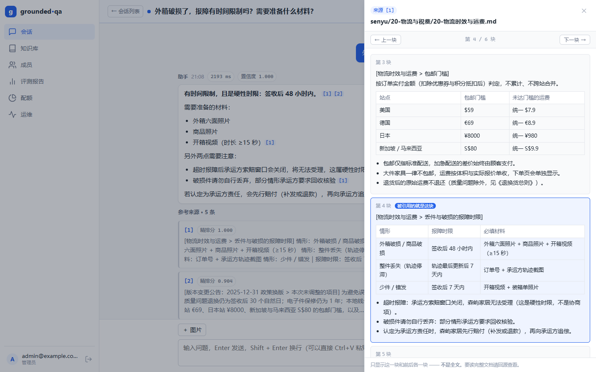
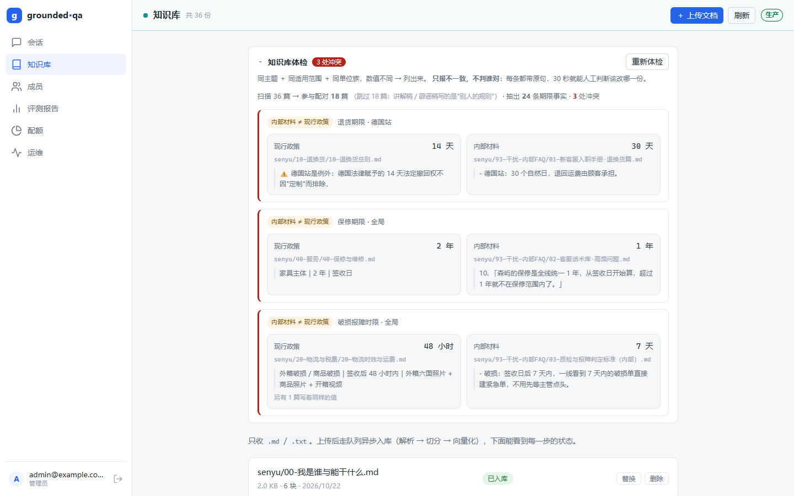
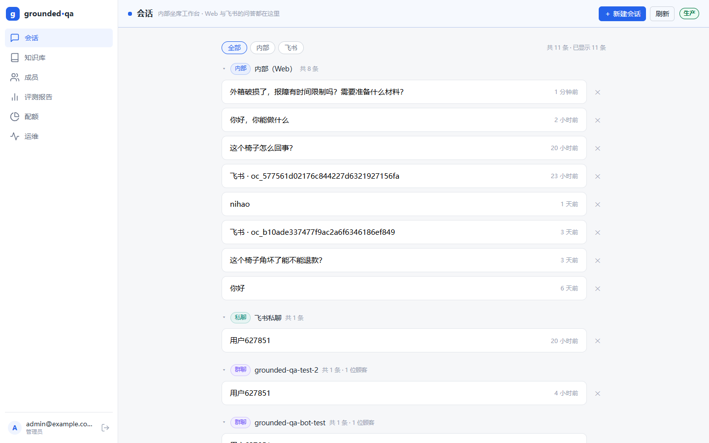
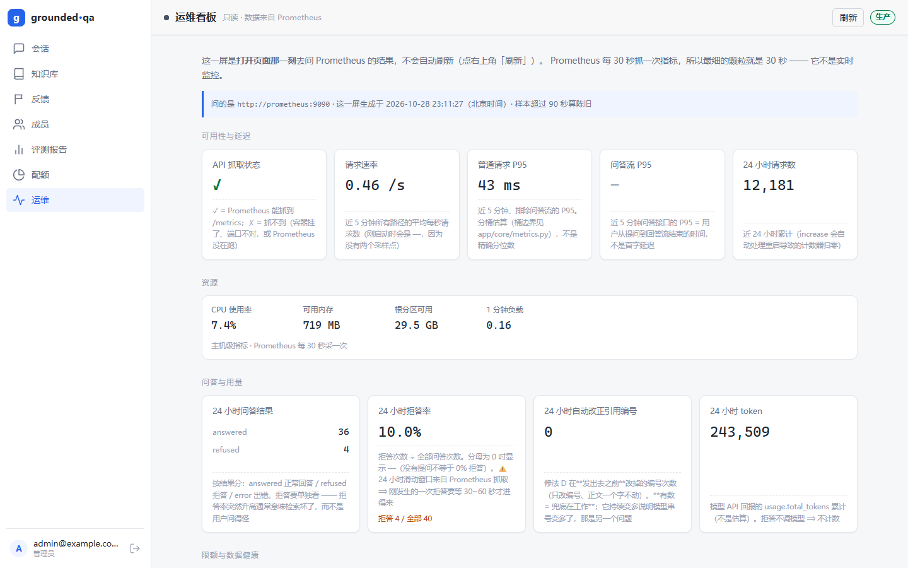

# grounded-qa

> **多租户知识库问答平台** —— 把企业私有文档变成"能问、能答、答错能查证、查不到敢说不知道"的客服系统。
> 深度锚不是"接个大模型"，是**检索质量与幻觉治理**。

**生产**：[http://120.24.67.82:8080](http://120.24.67.82:8080) ｜ 测试 **464 项**（439 通过 · 25 跳过） ｜ 最后更新 2026-10-25


![一问一答：`[n]` 引用、精排分、置信度](docs/images/chat.png)



三件事把它和"套壳聊天"分开：

1. **答错能查证** —— 每条结论挂 `[n]`，落库到 `messages.citations`；点开看到的是**命中那一块原文**，不是一个笼统的"来源文件"。
2. **没依据敢拒答** —— 由**调模型之前**的确定性代码判定，拒答**一个 token 不花**，落库、可统计、可优化。
3. **知识库本来就脏** —— 有废止版本、有内部手册和对外总则打架、有故意写错的数字。这一层单独做，见[知识库治理](#知识库治理)。

## 能力

| 能力 | 做法 |
|---|---|
| **多租户隔离** | 每张业务表带 `tenant_id`，查询强制走仓储层（`WHERE` 焊进查询构造，没有"忘记加"这个选项）；**越权一律 404**（403 等于承认数据存在） |
| **登录鉴权** | JWT（HS256）＋ bcrypt，`admin` / `member` 两种角色；**不做开放注册**，账号由管理员在「成员」页建；改密码要验旧密码 |
| **混合检索** | `pg_trgm` 的 `word_similarity` ＋ pgvector 余弦 → **RRF（k=60）** → API 精排 |
| **引用溯源** | `[n]` 角标 → 来源卡（精排分 ＋ 命中块号）→ **看原文**抽屉（只取 `ordinal ± 1`，不拉整篇） |
| **低置信拒答** | 阈值只挂在**精排分 / 向量余弦**上（挂在 RRF 名次上等于永远不拒答）；拒答也落库；前端把候选折叠成「未采用的候选」 |
| **文档入库** | 上传 → Redis 队列 → mini worker 解析 / 切分 / 向量化（请求路径上不碰 embedding）；支持替换与删除 |
| **提问带图** | 图片 → **一次**视觉调用 → 结构化文字 → 走**同一套文本检索**（图不进向量空间）；图里的单号精确查订单表 |
| **短追问改写** | 「那保修呢？」用上一轮问句补齐检索词 —— **规则拼接，不调模型**；界面用 chip 标"已合并上一轮检索" |
| **知识库治理** | ① 按 `ref_time` 选版本 ② 冲突体检（每天 09:30 推飞书） ③ 引用串号审计（只抓不改） |
| **Web ＋ 飞书** | **Web ＝ 内部坐席工作台，飞书 ＝ 顾客侧**；一个内核、两套展示档；会话按「内部 / 飞书私聊 / 飞书群聊」三级分组 |
| **可观测** | `/healthz` · `/metrics` · 三道启动自检 · 自研看板（API 代查 Prometheus）· 一条真告警 |
| **评测体系** | 三层判分（检索 / 生成 / 拒答）× 三组对照 × 双知识库 × 60 题，**全程不用 LLM 当裁判** |

## 一次提问经过什么

```
浏览器 / 飞书群
   │  POST /api/v1/conversations/{id}/messages（SSE）
   ▼
FastAPI ─ 意图路由 ─▶ 混合检索：全文路 ＋ 向量路（各取 top-k，版本过滤写进两条路的 WHERE）
                        └▶ RRF 融合 ─▶ API 精排 ─▶ 拒答判定（阈值在这里，调模型之前）
                                                └▶ 生成（带 [n]）─▶ 引用串号审计
   ▼
sources → delta* → done    ← SSE 手写切帧；nginx 对这个 location 关缓冲

PostgreSQL 16 + pgvector（语料 / 向量 / 会话）    Redis（语义缓存 ＋ BLPOP 队列 ＋ 配额记账）
mini worker（解析 → 切分 → 向量化）              外部 API（对话 / 多模态 / embedding / rerank）
飞书：出站**长连接** —— 不需要公网回调、不需要证书
```

两条不动的原则：**一套知识库、一套向量库、一套 embedding 配置**（换模型不重嵌入 → 检索质量**静默变差**）；
**核心接口 OpenAI 兼容** —— 网页、飞书、任何客户端零成本接入。

## 几个不显然的决定

每条只给结论和数字，**详细解释一律在 [`docs/architecture.md`](docs/architecture.md)**（同一件事写两遍，两份迟早不一致）。

| 结论 | 证据（关键数字） | 详见 |
|---|---|---|
| **RAG 的增益得归因到检索，不是提示词** | 闭卷 28.9% → 随机证据 10.5% → 开卷 **94.7%**；随机证据比闭卷还差 18.4 pt ⟹ 提示词自己造成伤害，检索兜回 84.2 pt | §9.41 |
| **相关度 ≠ 有效性，时间不许进相关性分数** | 现行 0.980 vs 废止 0.979 —— 相似度**在结构上就分不开版本**；eligibility 是布尔，过滤写进召回 `WHERE`，不是召回后再筛 | §9.36 |
| **拒答必须在调模型之前判完** | 13/15 拒答**一个 token 没花**；让模型自己判断 ⟹ 拒答率变成"模型心情的副产品"，统计不出来也优化不了 | §5.2 · §5.3 |
| **冲突检测只认三个"同"** | 同主题 ＋ 同适用范围 ＋ 同单位族但值不同 → 199 处假冲突收口到 **3 处真冲突**、假阳性 0；代价是召回率低 | §9.39 |
| **引用串号只抓不改** | 改写已流式发出的回答会留下两个版本，**误删正确引用比标错更糟** → 只在 `done` 事件和飞书末尾降级提示 | §9.38 |
| **中文全文检索曾"静默全失效"** | `ctype=C` 时 `show_trgm('退款政策')` 返回空集、相似度恒为 0，**而接口照样 200**；`C.UTF-8` 下 0.4 | §4.4 |
| **不用 Celery / 独立向量库 / Grafana** | 单机低频批处理，约 40 行 `BLPOP` 就够；多租户过滤能和向量检索写在**同一个 `WHERE`**里；2C2G 上少一个百 MB 级进程 | §9.26 · §10.1 |
| **2C2G 上每个容器都设 `mem_limit`** | 上限给顶格 ＝ **静默崩溃，日志是空的**（容器 `healthy`，因为 healthcheck 只看进程在不在） | §2.3 |

## 评测：把话量出来

**双知识库**：A 库是公开文档（证明工程规模）；**B 库是自造语料**（证明检索真的有效）。公开内容大模型早背过了，
检索到没检索到都能答对 —— 所以**成绩只看 B 库**。语料与题集**进仓库**（`evals/corpus/` · `evals/questions/`），别人要能复现。

> ⚠️ **语料、题集、订单全部是虚构的**：公司"森屿家居"、36 篇政策文档、20 条演示订单（`app/db/seed.py`）都是编的；
> 订单表是**只读演示表**，不接任何真实业务系统（没有对接任何电商平台）。

**① 检索层**（60 题，B 库，`--top-k 5`）

| 消融组 | 命中率@5 | MRR |
|---|---|---|
| 纯全文（`pg_trgm`） | 0.567 | 0.368 |
| 纯向量（pgvector） | 0.933 | 0.783 |
| 混合（RRF） | 0.917 | 0.713 |
| **混合 ＋ API 精排** | **0.983（59/60）** | **0.885** |

**② 生成层**（20 题，同一套题 / 同一个模型 / 同一个判分器，只换"有没有检索"）

| 组 | 全通过 | 要点命中 | 出现禁用内容 |
|---|---|---|---|
| 闭卷（关 RAG） | 1/20 | 28.9% | 0/20 |
| 随机证据（开卷提示词 ＋ 无关段落） | 0/20 | 10.5% | 1/20 |
| **开卷（真检索）** | **16/20** | **94.7%** | 0/20 |

- **③ 拒答层**：15/15 行为正确 · 13/15 真的拒答 · **13/15 一次模型都没调**。
- **④ 读图**：单图理解 7/7；带图 2/3 vs 不带图 0/3 —— 图是"线索"，不是"知识"。

```bash
uv run python evals/run.py --layer retrieval  --kb senyu --scope current --top-k 5   # 四组消融
uv run python evals/run.py --layer generation --kb senyu --mode all                  # 闭卷 → 随机 → 开卷
uv run python evals/run.py --rescore evals/results/<某次结果>.json                   # 只换尺子重算，不调模型
```

**已知短板（老实写）**：`ret-51` 永远召回不到，因为答案只出现在不可引用的「内部判定标准」里，留着当漏召回的锚点；
冲突检测只认 4 个主题的期限句；短追问只做单轮规则拼接（"那第三单呢"不管）。

> ⚠️ **别把"测试"和"评测"搞混**：单元测试**绝不真调模型**（烧钱 ＋ 不稳定 → 一律 mock）；评测跑批**必须真调** —— 它就是来量真实表现的。

## 知识库治理

| 问题 | 做法 | 实测 |
|---|---|---|
| **哪一版才算数** | 文档带 `content_status`（active / superseded / drafts）＋ 生效区间；召回按 **`ref_time`** 过滤（闭区间），老订单问的是当年那版 | 现行 0.980 vs 废止 0.979 → 相似度分不开，只能靠 `WHERE` |
| **两份文档互相打架** | 同主题 ＋ 同适用范围 ＋ 同单位族但值不同 → 列出来，**两条都带原句**，不判谁对 | 199 → **3 处**（假阳性 0） |
| **引用标错号** | 核对回答里的"数字＋单位"是否真在被引段落里，**只抓不改** | 生产 badcase（`6 个月` 标成 `[2]`，实际在 `[3]`）现在抓得出来 |



体检在「知识库」页里，**点开才算**（现算、只读）；每天 09:30 由 `systemd timer` 跑一次，**没有冲突就不推**，
推送失败会让任务退出非零 —— 不静默。

## 渠道：Web 是内部工作台，飞书是顾客侧

一个问答内核，两种展示档：**Web 默认详细**（分数 / 置信度 / 候选全给），**飞书默认简洁**（答案 ＋ 来源）。
飞书走自建应用机器人的**长连接**，回复用**卡片**（`lark_md` 不认表格和标题，得先降级成列表行）。



群里**按人分桶**（10 个人问过 = 10 条会话）—— 群聊上下文天然混在一起，不按人分会串台。

> **为什么没有注册页**：这是内部工作台（知识库、评测、配额、运维都在这儿），开放注册等于把知识库公开，还会被刷 token 额度。
> 账号由管理员建；登录页另有「一键演示账号」按钮，生产**默认关闭**（`DEMO_LOGIN_ENABLED=false`），要用改一个环境变量。
> 打开后进入的是**只读管理员**：知识库 / 评测报告 / 运维 / 冲突体检 / 全部会话都能看，但**上传、删除、建成员一律 403** ——
> 看得到项目的全部能力，改不动任何数据（删文档是硬删、建成员能给自己留后门，所以这条必须拦）。

> **告警机器人只挂一个群**：飞书的自定义 webhook 是"一个群一条 URL"，多群意味着每建一个群都要改服务器 `.env`。
> 告警要的是"一个**一定被看到**的地方"，不是"每个群都刷一遍"。问答机器人不受这条限制，可以进任意多个群。

## 快速上手

**前置**：Docker（依赖服务一律 compose 起）、[uv](https://docs.astral.sh/uv/)、**Node ≥ 22.13** ＋ pnpm 11.7（再低 pnpm 直接拒绝运行）。

```bash
cp .env.example .env                 # 填自己的 API Key；.env 已被 .gitignore 忽略
docker compose up -d                 # PostgreSQL + Redis + api + worker
uv run alembic upgrade head          # 建表（含 pgvector 扩展）
uv run python -m app.db.seed         # 默认租户 + 管理员 + 20 条演示订单（幂等）
cd web && pnpm install && pnpm dev   # http://localhost:5173
```

- ⚠️ **本机端口整块挪到 5 万段**（这台开发机还跑着别的项目）：PostgreSQL **55432** / Redis **56379** / API **58000**；容器名 `gq-` 前缀、卷 `gq-*` 显式命名，绝不复用别的项目的容器和卷。
- ⚠️ **建库参数必须是 `C.UTF-8`**（`POSTGRES_INITDB_ARGS`）：`ctype=C` 会让中文全文检索**静默全失效** —— 接口照样 200。
- 只想起后端：`uv run uvicorn app.main:app --reload --port 8000`；检查：`uv run ruff check .` · `uv run pytest -q -rs`（连不上库会 SKIP，不是失败）。
- 接口文档在 `/docs`；统一前缀 `/api/v1`，除登录外都要 `Authorization: Bearer <token>`；**429 带 `Retry-After`**、**越权一律 404**。

## 部署与可观测

服务器是阿里云**轻量应用服务器** 2 核 2G（⚠️ 不是标准 ECS —— 端口在控制台**「防火墙」**里管，不叫「安全组」），内存是硬约束：

- 镜像**在 CI 构建 → 推 ACR → 服务器只 `pull`**，绝不在 2C2G 上 `docker build`；
- CD：`ssh` → `compose pull` → `up -d --profile monitoring` → 轮询 `/healthz` → **失败自动回滚**；
- 8 个容器全部 `mem_limit` ＋ `healthcheck`；服务按 **`:8080`** 规划（不做 HTTPS，飞书走长连接本就不需要证书）；
- 两个 `systemd timer`：**03:00 备份**（`pg_dump -Fc`，留 7 份）· **09:30 冲突体检**；
- 告警链：Prometheus 只负责**算**，一个 60 秒的搬运工读 `/api/v1/alerts` 推群机器人（不引 Alertmanager；代价：api 挂了就不推）；
- 备份的价值只有恢复过才算数 —— 恢复演练**连结构一起比**，只看行数会漏掉"数据都在、向量没了"。



部署配置见 [`deploy/`](deploy/)。

## 目录结构

```
app/            api（HTTP / SSE）· core（配置·鉴权·多租户·计量·告警）
                rag（检索 → 精排 → 生成 → 拒答 → 引用审计）· kb（冲突体检）
                channels（web / 飞书长连接）· db（模型·迁移·仓储层）· workers（mini worker）
web/            前端（Vue 3 + TypeScript + Vite）
evals/          评测体系（进 git）：corpus/ 自造语料 · questions/ 题集 · results/ 结果 JSON
tests/          单元 ＋ 集成测试
deploy/         nginx / Prometheus / 服务器初始化 / systemd 单元
docs/           architecture.md · images/
```

## 文档

| 文件 | 写什么 |
|---|---|
| [`docs/architecture.md`](docs/architecture.md) | **为什么这么做**：每个不显然的决定（怎么做 → 天真做法会怎样 → 代价），以及 §10「故意不做」清单 |
| [`AGENTS.md`](AGENTS.md) | 给 AI 编码助手的操作手册：命令、约定、已知坑、禁区 |
| [`docs/records/`](docs/records/) | 评测批次留档 |

**安全红线**：服务端不执行任何用户提交的代码或命令；模型全部走外部 API（这台机器没有 GPU，也不跑本地模型）。

## 许可

MIT
