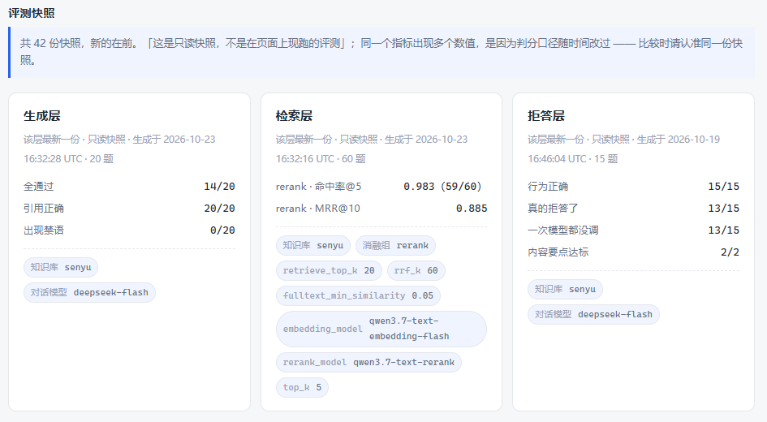
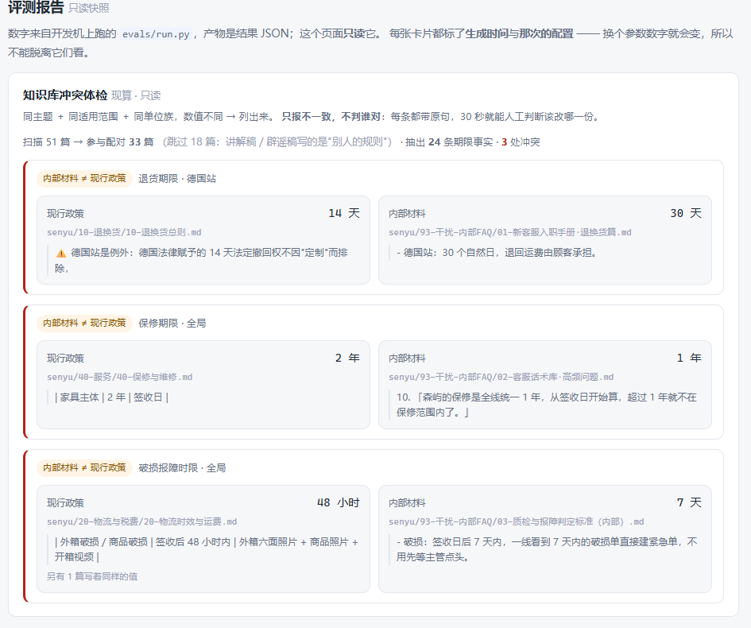
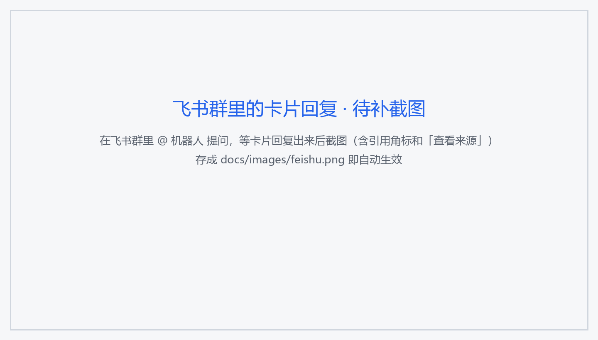

# grounded-qa

> **状态：v1.4 收官（2026-10-24）** ｜ 生产：<http://120.24.67.82:8080> ｜ 测试 **417 项**（单元 ＋ 集成） ｜ 最后更新 2026-10-24

**多租户知识库问答平台** —— 客服是它的第一个业务场景。
深度锚是**检索质量与幻觉治理**：混合检索（全文 ＋ 向量 → RRF → API 精排）、**带引用溯源**的生成、
低置信度**拒答**、**按参照时刻选版本**的知识库治理，以及一套 **闭卷 / 随机证据 / 开卷** 三组对照的评测体系。


> **它解决什么问题**：把企业私有文档变成"能问、能答、答错能查证、查不到敢说不知道"的服务。
> 公开文档上 RAG 的增益其实有限（模型参数化记忆已覆盖），真正的价值集中在**私有 / 长尾 / 版本敏感**的知识上。
> 这个项目把这句话**量出来**，也包括对我不利的数字（见 [评测](#评测把话量出来)）。

---

## 目录

- [它是什么](#它是什么)
- [快速上手](#快速上手)
- [接口](#接口)
- [架构](#架构)
- [设计取舍一览](#设计取舍一览)
- [评测：把话量出来](#评测把话量出来)
- [知识库治理](#知识库治理)
- [渠道：飞书](#渠道飞书)
- [部署与可观测](#部署与可观测)
- [目录结构](#目录结构) · [开发约定](#开发约定) · [许可](#许可)

---

## 它是什么

| 能力 | 说明 |
|---|---|
| **多租户隔离** | 所有业务表带 `tenant_id`；查询统一走**强制注入租户条件的仓储层**，写入侧连客户端传 `tenant_id` 都直接报错。越权一律 **404**（403 等于承认数据存在，可被用来枚举） |
| **登录鉴权** | JWT（HS256）· bcrypt · 管理员 / 成员两种角色 · "密码错"与"用户不存在"返回**完全相同**的响应**和耗时** |
| **混合检索** | PostgreSQL 全文（`pg_trgm` `word_similarity`）＋ pgvector 向量 → **RRF（k=60）** → API 精排 |
| **引用溯源** | 每条回答带 `[n]` 角标，落库到 `messages.citations`，点开就是原文段落 + 精排分；另有**引用审计**：核对"数字＋单位"是否真在被引段落里，**只抓不改** |
| **低置信拒答** | 由**调模型之前**的确定性代码判定（阈值只挂在精排分 / 向量余弦上）；拒答落库（`messages.refused`）、**可统计**、**一个 token 不花** |
| **文档入库** | 上传 → Redis 队列 → mini worker 解析 / 切分 / 向量化，请求路径上不碰 embedding |
| **提问带图** | 图片 → **一次**视觉模型调用 → 结构化文字 → 走**同一套文本检索**（图不进向量空间）；图里的单号**精确查**只读订单表（租户 ＋ 用户两道过滤） |
| **知识库治理** | ① 相关度 ≠ 有效性：**按 `ref_time` 选版本**（老订单的正确答案就是当年那版）② 冲突体检：同主题 ＋ 同适用范围 ＋ 同单位族但值不同 → 每天 09:30 推飞书 ③ 引用串号审计 |
| **短追问改写** | "那保修呢？" → 用上一轮问题补齐检索词（**规则拼接，不调模型**），单轮实现、可测可回滚 |
| **飞书渠道** | 自建应用机器人走**长连接**（出站，不需要公网回调、不需要 HTTPS）＋ 卡片回复（`lark_md` 不支持表格/标题，得先降级） |
| **可观测** | `/healthz` · `/metrics`（Prometheus）· **三道启动自检**（中文全文检索 / 拒答阈值与模型配套 / 向量元数据）· 自研看板（API 代查 Prometheus）· 一条真实告警 |
| **评测体系** | 三层判分（检索 / 生成 / 拒答）× 三组对照 × 双知识库 × 60 题检索集，**全程不用 LLM 当裁判** |

**安全红线**：**服务端不执行任何用户提交的代码或命令**；所有模型调用走外部 API，服务器上不跑本地模型（2C2G 也没有 GPU）。

---

## 快速上手

**前置**：Docker（依赖服务一律用 compose 起，不装到宿主机）、[uv](https://docs.astral.sh/uv/)、**Node.js ≥ 22.13** ＋ pnpm 11.7
（⚠️ 不是 "≥ 20"：`packageManager: pnpm@11.7.0` 要求 Node ≥ 22.13，低了 pnpm 直接拒绝运行）。

```bash
cp .env.example .env       # 填自己的 API Key；.env 已被 .gitignore 忽略
docker compose up -d       # PostgreSQL + Redis + api + worker
curl http://127.0.0.1:58000/healthz

uv run alembic upgrade head    # 建表（含 pgvector 扩展）
uv run python -m app.db.seed   # 默认租户 + 管理员 + 20 条演示订单（幂等）

cd web && pnpm install && pnpm dev   # http://localhost:5173
```

> ⚠️ **本机端口整块挪到 5 万段**（这台开发机还跑着别的项目）：PostgreSQL **55432** / Redis **56379** / API **58000**
> （容器内仍是标准端口）。容器名 `gq-` 前缀、卷 `gq-*` 显式命名，绝不复用其他项目的容器。
> 🗄️ **建库参数必须是 `C.UTF-8`**（`POSTGRES_INITDB_ARGS`）：`ctype=C` 时 `pg_trgm` 认为中文不算字母 →
> 中文全文检索**静默全失效**（`show_trgm('退款政策')` 返回空集、相似度恒为 0，而接口照样 200）。应用启动会自检并告警。

**本地不开容器**：`uv sync && uv run uvicorn app.main:app --reload --port 8000`（接口文档在 `/docs`，右上角 Authorize 可直接登录）。
**检查**：`uv run ruff check .` · `uv run ruff format --check .` · `uv run pytest -q -rs`（集成测试连不上库会 **SKIP**，不是失败）。

---

## 接口

统一前缀 `/api/v1`（来自配置）。除登录外都要 `Authorization: Bearer <token>`。

| 方法 | 路径 | 说明 |
|---|---|---|
| `POST` | `/auth/login` | 表单登录 → JWT（"密码错"与"用户不存在"响应与耗时完全相同） |
| `GET` | `/auth/me` | 当前用户（角色 / 租户） |
| `GET` / `POST` | `/conversations` | 会话列表 / 新建（**懒创建**：第一次提问时才真正建会话） |
| `GET` | `/conversations/{id}/messages` | 消息列表（刷新页面后恢复上下文） |
| `POST` | `/conversations/{id}/messages` | **提问 —— SSE 流式**：`sources` → `delta`* → `done`（带 `citation_audit`），出错发 `error` |
| `POST` / `GET` | `/documents` | 上传（**仅管理员**，只吃 `.md`/`.txt`）→ **202** 异步入库 ／ 列表（带 `status`，界面靠它轮询） |
| `GET` | `/reports` | **只读**评测报告（只给聚合数字，不吐逐题明细） |
| `GET` | `/reports/conflicts` | **知识库冲突体检**（仅管理员，**现算**、只读、不判对错） |
| `GET` | `/usage/me` · `/usage/tenant` | 今日 token 用量 / 配额（读 Redis 记账；**取不到返回 `null` 而不是 0**） |
| `GET` | `/monitoring/snapshot` | 运维看板（仅管理员；**服务端代查** Prometheus，客户端传不了 PromQL） |
| `GET` | `/healthz` · `/metrics` | 判活 / Prometheus 抓取 |

**两个会被客户端撞到的约定**：

- **429** 带 `code` / `scope` / `used` / `limit` / `retry_after_s` ＋ 标准 `Retry-After` 头 —— 前端照着退避，**不要立刻重试**。
- **越权一律 404**，只有"已登录但角色不够"才给 403。

---

## 架构

```
                    ┌────────────────────────────────────┐
   访客 / 工作台 ──▶ │  nginx :8080                       │
                    │  反代 · 限流 · 静态缓存 · SSE 不缓冲  │
                    └───────────────┬────────────────────┘
                                    ▼
                    ┌────────────────────────────────────┐
                    │  自研 API（FastAPI）                │
                    │  意图路由 → 混合检索 → 精排 → 生成    │
                    │  （引用溯源 ＋ 拒答）· SSE 流式返回   │
                    └───┬───────────────┬────────────────┘
                        ▼               ▼
            ┌────────────────┐  ┌──────────────┐
            │ PostgreSQL 16  │  │   Redis      │
            │  + pgvector    │  │ 语义缓存+队列  │
            └───────┬────────┘  └──────┬───────┘
                    ▲                  ▼
                    │        ┌────────────────────┐
                    └────────│ 自研 mini worker    │
                             │ 解析/切分/向量化      │
                             └─────────┬──────────┘
                                       ▼
                             外部 API（对话 / 多模态 / embedding / rerank）

  飞书群 ──@ 机器人──▶ 飞书开放平台 ◀══长连接（出站）══ feishu 渠道容器
                                                      └── HTTP ──▶ 自研 API
                                                        （同一条问答链路，回复渲染成卡片）
```

> ⚠️ 飞书**是出站长连接**：不需要公网回调、不需要证书 —— 这是"不做 HTTPS"能成立的前提。

两条设计原则：**一套知识库、一套向量库、一套 embedding 配置**（换模型必须全量重嵌入，否则检索质量**静默变差**）；
**核心接口 OpenAI 兼容** → 网页 / 飞书 / 任何客户端零成本接入。

**为什么这么做**（每个不显然决定的"做法 → 为什么 → 代价"）→ [`docs/architecture.md`](docs/architecture.md)。
建议先读 §1「一次提问经过哪些环节」，再挑关心的节。

---

## 设计取舍一览

**这张表是项目的"金句集"**：每条只有「一句话结论 ＋ 关键数字 ＋ 去哪看」。⚠️ **详细解释一律在
[`docs/architecture.md`](docs/architecture.md)，这里刻意不抄** —— 同一件事写两遍，两份迟早不一致，而**不一致的那份会被人当真**。

| 结论（一句话） | 关键数字 / 证据 | 详见 |
|---|---|---|
| **RAG 到底有没有用？只有三组对照答得了** | 闭卷 **27.6%** → 随机证据 **10.5%** → 开卷 **93.4%**（要点命中）。**随机证据比闭卷更差 17.1 pt** ⟹ 这一截是提示词造成的伤害，真正的增益 **82.9 pt** 全来自检索 | §9.41 |
| **闭卷不是"答不出"，是"自信地编"** | 20 题里 18 题照样给出具体数字，要点命中率仅 26.3%，禁用内容 0 条 —— 它**看起来一样可信** | §9.34 · §9.41 |
| **判分器自己也会误判，得先修尺子** | 第一版按"必须原样出现"判 → 11/20；改成**数字集合比对**（"一层"=1、"09:00"、"fastapi dev"）后 18/20，且零回归 | §9.34 ⑨ |
| **题量 25 → 60 是靶纸变严，不是分数变差** | 25 题 1.000 → 60 题 **0.983（59/60）· MRR 0.885**；新题带 `evidence` 由**机器核对**，不再靠人审 | §9.34 ⑩ |
| **相关度 ≠ 有效性：版本判断必须走 `ref_time`** | 现行 0.980 vs 废止 0.979 —— 相似度**在结构上就分不开版本**；过滤写进两条召回路的 `WHERE`，**不是召回后再筛**（第 21 名永远补不上） | §9.36 |
| **时间永不进相关性分数** | 混进去就会变成"越新越相关"，badcase 归因不出来。正确切法：**relevance 是分数，eligibility 是布尔** | §9.36 |
| **冲突检测只认"同主题 ＋ 同范围 ＋ 同单位族"** | 199 处假冲突 → 收口到 **3 处真冲突**（语料里故意写错的 3 处全抓到、假阳性 0）；代价是**召回率低**（只认 4 个主题的期限句） | §9.39 ③′ |
| **引用串号"只抓不改"** | 改写已流式发出的回答会留下两个版本，**误删正确引用比标错更糟** → 只在 `done` 事件和飞书末尾给降级提示 | §9.38 · §9.40 |
| **短追问不改写就检索不到** | 6 组实测：2 组由"召回不到"变"召回得到"，最好的一组从第 **4 名进到第 1 名**，0 组变差。**规则拼接（≤15 字 + 代词）不调模型** | §9.42 |
| **拒答在调模型之前就判完了** | 拒答**一个 token 都不花**；拒答率**可统计、可优化**，不会变成"模型心情的副产品" | §5.2 |
| **置信度阈值只能挂在精排分或向量余弦上** | RRF 是**名次**的函数：库里只有一条不相关内容时它照样排第一 → 拿它比阈值 ＝ **永远不拒答** | §5.3 |
| **阈值 0.60 是实测标出来的，不是拍的** | 20 条样本：相关 **0.786~0.990** ／ 无关 **0.009~0.466**，中间空了 0.32；换精排模型或换语料 → **必须重标**，应用**启动自检**这一对 | §5.3 |
| **两条检索路的失败模式不同，所以两条都要留** | 向量强在语义、弱在**错误码 / 型号**；客服场景恰恰大量是后者 | §4.1 |
| **RRF 只用名次，不用分数** | 两种分数量纲不同，各配权重就是拍脑袋；`k=60` 用来压平头部 | §4.2 |
| **中文全文检索曾经"静默全失效"** | `ctype=C` → `show_trgm('退款政策')` 返回空集、相似度恒为 0；`C.UTF-8` → 0.4。**而接口不报错、状态码 200** | §4.4 |
| **「混合检索比纯向量好多少」只有中文语料答得了** | 英文语料上三组几乎一样 —— 全文路**根本没参与**，这不是"数据不好看"，是**实验设计上就测不到** | §4.7 |
| **多租户隔离焊死在仓储层** | 你**没有"忘记加 `WHERE tenant_id`"这个选项**；元测试守着"每张业务表必须有 `tenant_id`" | §2.2 · §2.5 |
| **JWT 里带了租户 id，每个请求仍回库核对** | 否则"人已离开这个租户，旧 token 还能读它的数据" | §3.6 |
| **「详细程度」开关藏的是分数，不是来源** | 数据层永远存全（**拒答也落** `citations` ＋ `confidence`），分档只发生在界面层 | §9.19 |
| **SSE 手写切帧，不用 `EventSource`** | `EventSource` 只能发 GET；而且帧会被网络切开、**一个汉字可能被切成两半** | §9.12 |
| **不用 Celery / 不用独立向量库 / 不引 Grafana** | 单机低频批处理，**约 40 行 `BLPOP`** 就够；向量检索和多租户过滤能写在**同一个 `WHERE`** 里；2C2G 上少一个 ~100 MB 的进程。**代价都写清了**（无历史回看 / 无告警静默） | §10.1 · §9.29 |
| **"不做 HTTPS"是决定，不是遗漏** | 飞书走**长连接（出站）**，本就不需要证书和公网回调 | §10.2 |
| **2C2G 上每个容器都有 `mem_limit`** | 容器预算 **≈ 670 MB ／ 可用 ≈ 1.2 GiB**。⚠️ 上限给顶格 ＝ **静默崩溃，日志是空的**（feishu 进程 anon ≈ 197 MiB） | 计划书 §2.3 |
| **上传拆成「建行 → 排队 → 处理」三段** | 请求路径上不碰 embedding；字节落共享卷、消息里只有 UUID —— 否则一个 1 MB 文件 base64 后 1.3 MB，Redis 淘汰时会**静默丢消息**（表现：上传成功、永远 pending） | §9.26 |
| **限流与配额是两把尺子，且 Redis 挂了要放行** | 次数/分钟治「刷」、token/天治「烧钱」（软熔断）；缓存抖一下就整站 429 ＝ 把"缓存故障"升级成"服务不可用" → **fail-open 但必须留痕**（`gq_limit_failopen_total`），静默放行才是真问题 | §9.27 |
| **群机器人"发送成功"可能根本没发出去** | 飞书 webhook **被拒绝时也回 HTTP 200**，错误在 body 的 `code` 里 → 不校验业务码就会把"没投递"记成"已投递"、永不重推 | §9.30 ⑤ |
| **备份的价值只有恢复过才算数** | 每天 03:00 `systemd timer`（这台机 `cron` 没在跑）`pg_dump -Fc` 留 7 **份**；恢复演练**连结构一起比** —— 只看行数会漏掉"数据都在、向量没了" | §9.32 |
| **压测第一版结论是错的，而且是量错的** | 顺序比 "pre_ping 开→关" 得到 +22%，其实是**冷启动 vs 热态**；交替测量后差异完全消失 ⟹ **没有为性能改任何默认值** | §9.33 |
| **已知的将就也一并写出来** | 例：`citations` 字段**混装两种含义**（引用 / 检索候选）—— **字段名会撒谎** | §10.3 |

> 📌 **"故意不做"的完整清单**（K8s / Grafana / Elasticsearch / 微调 / 工单系统 / 跨租户超管 …）
> → architecture **§10**，每条都写了「为什么否掉 ＋ 什么时候该重新考虑」。

---

## 评测：把话量出来

评测是项目的**深度锚**，不是附属品。**双知识库**：A = 公开文档（证明工程规模）；**B = 自造语料（证明检索真的有效）**。
A 库的内容早在大模型训练数据里，检索到没检索到都能答对，所以**成绩一律看 B 库**。语料与题集**进仓库**
（`evals/corpus/` · `evals/questions/`），因为别人要能复现。

**① 检索层（60 题，B 库，`--top-k 5`，`scope=current`）**

| 消融组 | 命中率@5 | MRR |
|---|---|---|
| 纯全文（`pg_trgm`） | 0.567 | 0.368 |
| 纯向量（pgvector） | 0.933 | 0.783 |
| 混合（RRF） | 0.917 | 0.713 |
| **混合 ＋ API 精排** | **0.983（59/60）** | **0.885** |

**② 生成层（20 题，同一套题 / 同一个模型 / 同一个判分器，只换"有没有检索"）**

| 组 | 全通过 | 要点命中 | 数字命中 | 出现禁用内容 |
|---|---|---|---|---|
| 闭卷（关 RAG） | 0/20 | 27.6% | 18/20 | 0/20 |
| 随机证据（开卷提示词 ＋ 无关段落） | 0/20 | 10.5% | 10/20 | 1/20 |
| **开卷（真检索）** | **15/20** | **93.4%** | **20/20** | 0/20 |

⟹ 归因：**提示词 −17.1 pt · 检索 +82.9 pt**。只跑闭卷/开卷两组，会把"提示词造成的伤害"记到检索头上。

**③ 拒答层**：15/15 行为正确 · 13/15 真的拒答 · **13/15 一次模型都没调**。
**④ 读图**：单图理解 7/7；带图 2/3 vs 不带图 0/3（图是"线索"，不是"知识"）。



```bash
uv run python evals/run.py --layer retrieval --kb senyu --scope current --top-k 5     # 四组消融
uv run python evals/run.py --layer generation --kb senyu --mode all                   # 闭卷→随机→开卷 三组
uv run python evals/run.py --rescore evals/results/<某次结果>.json                    # 只换尺子重算，不调模型
```

### 证据索引：能力 → 数字 → 去哪看

| 能力 | 数字 | 位置 |
|---|---|---|
| 检索质量 | 精排 命中率@5 **0.983** · MRR **0.885**（60 题）；四组消融见上表 | §4.1–4.3 · §9.34 ⑩ |
| RAG 增益 | 闭卷 27.6% / 随机 10.5% / 开卷 93.4%；**提示词 −17.1 pt ／ 检索 +82.9 pt** | §9.41 |
| 引用可核对 | 开卷 20/20 引用正确；串号审计抓出生产 badcase | §9.38 · §9.40 |
| 拒答 | 15/15 行为正确 · 13/15 零 token | `docs/records/` |
| 读图 | 7/7 单图 · 带图 2/3 vs 0/3 | §9.35 |
| 版本治理 | 现行 0.980 vs 废止 0.979（相似度分不开） | §9.36 |
| 冲突体检 | 199 → **3 处真冲突**，假阳性 0 | §9.39 ③′ |
| 短追问 | 6 组：2 组新召回 · 最好 4 → 1 名 · 0 变差 | §9.42 |
| 多租户隔离 | 越权一律 404；元测试守"表必须有 `tenant_id`" | §2.2 · §2.5 |
| 英文语料为何测不出混合检索 | 三组几乎一样 —— 全文路**根本没参与**，是实验设计问题 | §4.7 |

### 已知短板（老实写）

- **`ret-51` 永远召回不到** —— 它的答案只出现在「内部判定标准」里，而那不是可引用的知识文档。**留着当"已知漏召回"的锚点**。
- **冲突检测只认 4 个主题的期限句**（破损报障 / 丢件少件 / 退货 / 保修）：召回率低是设计取舍，**只抓不改**。
- **短追问只做单轮规则拼接**："那第三单呢"这类多轮指代不管。
- 生成层同一层有**多份历史快照**（判分口径改过），横向比较前要**先对齐配置**。

> ⚠️ **别把「测试」和「评测」搞混**：单元测试**绝不真调模型**（烧钱 ＋ 不稳定 → 一律 mock）；评测跑批**必须真调** —— 它就是来量真实表现的。
> ⚠️ **不用 LLM 当裁判**：不可复现、还把成本推上去。

---

## 知识库治理

企业的知识库不是干净的：有存档版本、有内部手册和对外总则打架、有"这句话到底在说哪一年的政策"。
这一层解决三件事，**都不美化结论**：

| 问题 | 做法 | 实测 |
|---|---|---|
| **哪一版才算数** | 文档带 `content_status`（active / superseded / drafts）＋ 生效区间；召回时按 **`ref_time`** 过滤（闭区间）。老订单问的是**当年那版** | 现行 0.980 vs 废止 0.979，相似度分不开 → 只能靠 `WHERE` |
| **两份文档互相打架** | 同主题 ＋ 同适用范围 ＋ 同单位族（小时/天）但值不同 → 列出来，**两条都带原句**，不判谁对 | 199 → **3 处**（假阳性 0） |
| **引用标错号** | 核对回答里"数字＋单位"是否真在被引段落里，**只抓不改**（改写已流式发出的回答会留下两个版本） | 生产 badcase（`6 个月` 标成 `[2]`，实际在 `[3]`）现在抓得出来 |



体检每天 **09:30** 由 `systemd timer` 跑一次：**没有冲突就不推**，有冲突才推飞书（推送失败会让任务退出非零，不静默）。

---

## 渠道：飞书

自建应用机器人走**长连接**（出站），所以**不需要公网回调、不需要 HTTPS**；回复用**卡片**（`msg_type=interactive` ＋ `lark_md`，表格/标题要先降级成列表行）。
告警用的是**另一个** send-only 的群机器人 —— 与客服机器人**故意分开**，一个挂了不影响另一个。



> 📌 图片位说明：`docs/images/feishu.png` 需要真实飞书群截图（**机器人回复的卡片**，含引用角标）。
> ⚠️ 别 @ 错机器人：`alert-bot` 是**只发不收**的告警机器人，@ 它不会有任何反应。

---

## 部署与可观测

**服务器**：阿里云「轻量应用服务器」2 核 2G（⚠️ 不是标准 ECS —— 端口在控制台**「防火墙」**里管，不叫「安全组」），内存是硬约束：

- 镜像**在 CI 构建 → 推 ACR → 服务器只 `pull`**，绝不在 2C2G 上 `docker build`；
- CD：`ssh` → `compose pull` → `up -d --profile monitoring` → 轮询 `/healthz` → **失败自动回滚**；
- 服务按 **`:8080`** 规划（不做 HTTPS）；8 个容器全部 `mem_limit` ＋ `healthcheck`；
- 两个 `systemd timer`：**03:00 备份**（`pg_dump -Fc`，留 7 份）· **09:30 冲突体检**；
- 告警链：Prometheus 只负责**算**，一个 60 秒的搬运工读 `/api/v1/alerts` 推群机器人（不引 Alertmanager；代价：**api 挂了就不推**）。


> 📌 图片位说明：`docs/images/monitoring.png` 需要生产「运维」页整屏截图（本地开发栈没有 Prometheus）。

部署配置见 [`deploy/`](deploy/)。

---

## 目录结构

```
app/
├─ api/          HTTP 路由 / SSE 流式
├─ core/         配置、鉴权、多租户、日志、计量、告警
├─ rag/          解析 → 切分 → 嵌入 → 检索 → 精排 → 生成 → 拒答 → 引用审计
├─ kb/           知识库治理（冲突体检）
├─ channels/     渠道适配（web / feishu 长连接 ＋ 卡片）
├─ db/           表模型、迁移、仓储层
└─ workers/      异步任务（自研 mini worker）
web/             前端（Vue 3 + TypeScript + Vite）
evals/           评测体系（进 git）：corpus/ 自造语料 · questions/ 题集 · results/ 结果 JSON
tests/           单元 ＋ 集成测试
scripts/         run（本地启动）/ kb（知识库入库）
deploy/          nginx / 服务器初始化 / Prometheus / 运维脚本 / systemd 单元
docs/            architecture.md · images/ · evidence/ · records/ · archive/
.github/         CI/CD
```

---

## 配置

**所有可调项走环境变量，不硬编码。** 完整清单见 [`.env.example`](.env.example)，关键项：

| 变量 | 说明 |
|---|---|
| `LLM_MODEL` / `LLM_API_KEY` | 对话模型（当前 DeepSeek `deepseek-flash`，可换任何 OpenAI 兼容端点，**配置里必须带 `/v1`**） |
| `EMBEDDING_MODEL` / `EMBEDDING_DIM` | embedding（当前百炼）。**这是元数据锁**：换模型必须全量重嵌入 |
| `ANSWER_MIN_SCORE` / `ANSWER_MIN_COSINE` | 拒答阈值。前者只对**精排分**、后者只对**向量余弦**（rerank 不可用时兜底）—— **不是同一个量纲，不能互相套用** |
| `RETRIEVE_TOP_K` / `RERANK_TOP_N` / `RRF_K` | 检索与融合参数 |
| `RATE_LIMIT_PER_MINUTE` / `TOKEN_QUOTA_PER_DAY` | 两把尺子：次数/分钟、token/天 |
| `JWT_SECRET` | **≥ 32 字节**（HS256 硬性要求）；生产不换 → 应用**拒绝启动** |

---

## 开发约定

- **提交**：小步、语义化前缀（`feat:` / `fix:` / `docs:` / `chore:`）
- **格式**：ruff（`line-length = 100`）· 测试 pytest（`asyncio_mode = "auto"`）
- **换行**：`.gitattributes` 固定 `eol=lf`（Windows 开发 / Linux 跑，不固定就红）
- **文本文件**：一律 UTF-8 **无 BOM**
- **文档**：靠代码读不出来、又必须知道的坑 → [`AGENTS.md`](AGENTS.md) §10「已知坑」（每条都是踩过的）
- **不提交**：`.env` / 私有数据 / 构建产物

---

## 许可

MIT
